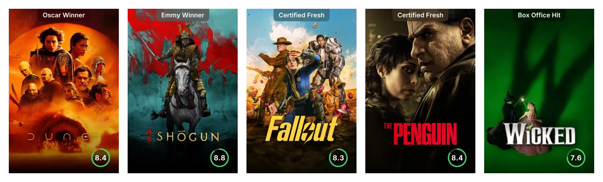
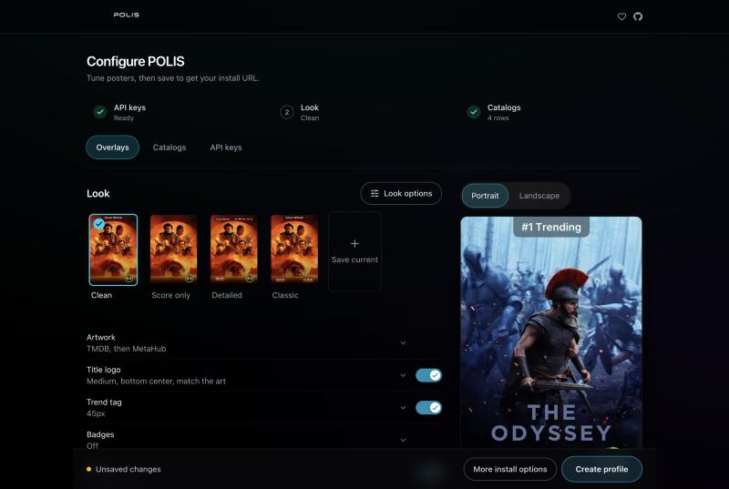
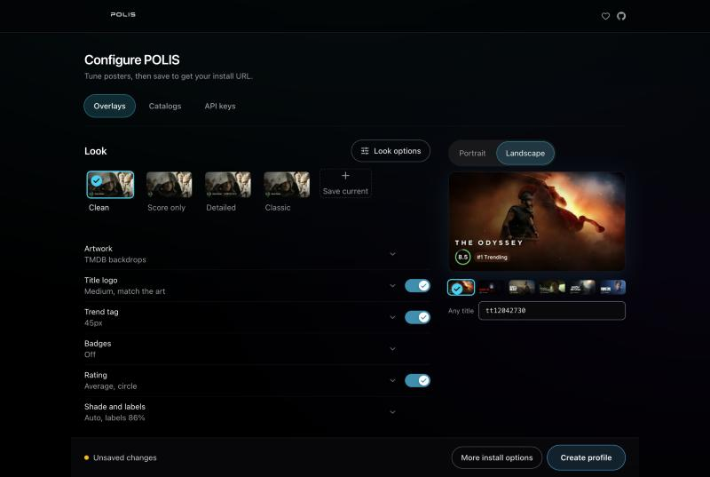
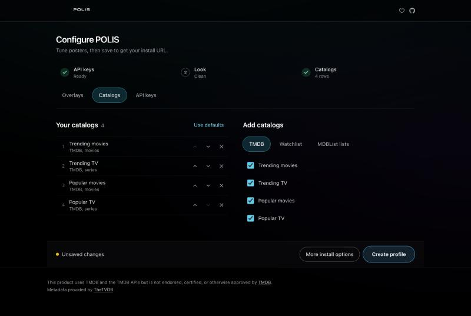
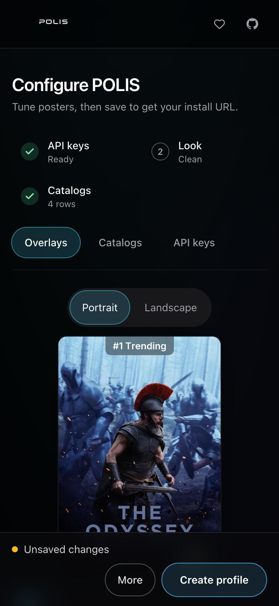
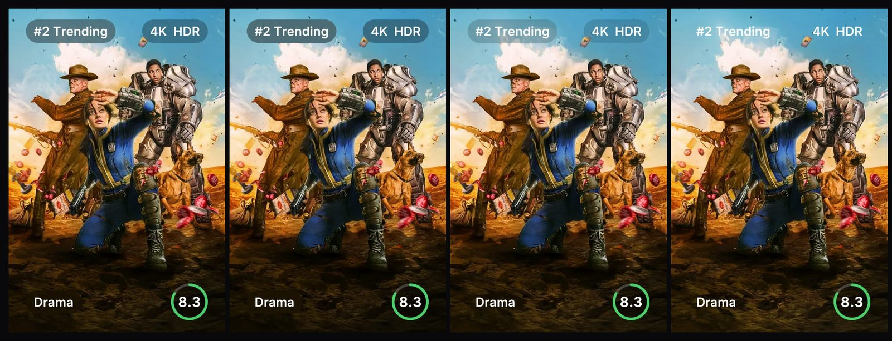

<p align="center">
  
</p>

# POLIS

Poster overlays for Stremio, Aurora Media Center and AIOMetadata: ratings, trend tags, quality badges and title logos, rendered on demand from IMDb ids.

<p align="center">
  
</p>

| Configure | Landscape |
| --- | --- |
|  |  |

| Catalogs | Phone |
| --- | --- |
|  |  |

## What it does

- **Renders posters on demand:** give it an IMDb id and it returns the poster with your overlays, as WebP by default. Results are cached on disk.
- **Shows ratings:** an average or a single source (IMDb, TMDB, Rotten Tomatoes, Metacritic, Trakt, Letterboxd, MDBList) as a ring or a star pill with optional score colors, or up to three sites side by side as badges on their own scales ("IMDb 8.4", "RT 92%", "LB 3.9").
- **Adds labels:** trend tags for trending titles, 4K, HDR and Dolby marks, age ratings and genres.
- **Places title logos:** from TMDB, Fanart.tv or TheTVDB, on a 3 by 3 grid, with a shadow and a scrim when the art behind is too bright.
- **Picks artwork:** TMDB, Fanart.tv, TheTVDB, MetaHub, AniList, Kitsu or MyAnimeList, with a fallback source.
- **Does landscape too:** backdrops with logo, score and trend tag for clients that show wide art.
- **Serves catalogs:** TMDB trending, popular, top rated, in theaters, upcoming, on the air and airing today, your MDBList watchlist, and any MDBList list, including the most-liked public lists. Rename them, reorder them, and keep any of them off Home so they only show in Discover.
- **Saves profiles:** each profile gets its own install URL and a password. Looks can be saved, shared as a code and edited as JSON.

<p align="center">
  
</p>

## Use it

Open the configure page on the public instance, [polis.thatscrazy.dev/configure](https://polis.thatscrazy.dev/configure), or on your own server.

1. Pick a look and adjust the parts you want.
2. Choose catalogs, or leave the defaults.
3. Select **Create profile** and set a password.
4. Select **Install in Stremio**, or copy the install URL into your player.

The install URL contains your profile id, and anyone with it can use POLIS with the keys saved in that profile. Don't post it publicly. If it leaks, open **More install options** and select **New install URL**; the old URL stops working. Saved keys are encrypted on the server.

### AIOMetadata

Open **More install options** to copy `customPosterUrlPattern` and `customLandscapeUrlPattern`. These work without a profile. The `{tmdb_key?}`, `{mdblist_key?}` and `{fanart_key?}` placeholders take the keys you already set in AIOMetadata. When they are empty, the server's keys are used.

### Keys on the public instance

The public instance has no server keys. Add your own TMDB and MDBList keys under **API keys**; Fanart.tv and TheTVDB are optional. Your keys are saved in your profile and used only for your posters and catalogs.

On a self-hosted server you can set server keys instead. Each profile then gets a daily share of them, and limits apply per client. Watchlist and list catalogs always need the visitor's own MDBList key.

## Self-host with Docker

Images are published for `linux/amd64` and `linux/arm64` as `ghcr.io/crazycacti/polis`, tagged `latest`, by version and by short commit.

```sh
mkdir polis && cd polis
curl -O https://raw.githubusercontent.com/crazycacti/polis/main/compose.yaml
curl -o .env https://raw.githubusercontent.com/crazycacti/polis/main/env.example
```

Edit `.env`. At minimum set `POLIS_PUBLIC_URL`, `POLIS_SESSION_SECRET` (`openssl rand -hex 32`) and a TMDB key. Then start it:

```sh
docker compose up -d
```

`compose.yaml` publishes port 3050 on `127.0.0.1` only. Put a reverse proxy in front that sets `X-Forwarded-For`, because per-client limits use it. With Caddy:

```
polis.example.com {
	reverse_proxy 127.0.0.1:3050
}
```

### Keep ids and keys out of proxy logs

Install URLs carry profile ids, and AIOMetadata patterns can carry API keys in the query string. Most proxies log full URLs, so drop or mask them. With Caddy:

```
polis.example.com {
	log {
		format filter {
			request>uri delete
			request>client_ip ip_mask 16 32
			request>remote_ip ip_mask 16 32
		}
	}
	reverse_proxy 127.0.0.1:3050
}
```

With nginx, log `$uri` (no query string) instead of `$request`, or turn `access_log` off for this site. With Traefik, set `accessLog.fields.names.RequestPath: drop` and `accessLog.fields.queryParameters.defaultMode: drop`.

Stored API keys are encrypted with a key derived from `POLIS_SESSION_SECRET`, or from `POLIS_DATA_KEY` when it is set. Keep that value: if it changes, saved keys can't be read and users have to enter them again.

Data lives in `./data`: `polis.sqlite` and the image cache. The container starts as root, hands `./data` to the `bun` user, then runs as `bun`. Don't set `user:` in compose, or that step is skipped. The image has a built-in health check on `/health`.

To update:

```sh
docker compose pull && docker compose up -d
```

## Configuration

Settings come from `.env`. Only the first group is needed.

**Required**

| Variable | Default | Purpose |
| --- | --- | --- |
| `POLIS_PUBLIC_URL` | request origin | Public base URL used in manifests and art URLs |
| `POLIS_SESSION_SECRET` | none | Signs configure sessions and encrypts saved keys. Required in production |
| `TMDB_API_KEY` or `TMDB_ACCESS_TOKEN` | none | Server TMDB key, used when a profile has none |

**Optional keys**

| Variable | Purpose |
| --- | --- |
| `MDBLIST_API_KEY` | Ratings. Never used for watchlists or lists |
| `FANART_API_KEY` | Fanart.tv artwork and logos |
| `TVDB_API_KEY` | TheTVDB artwork and logos |
| `TMDB_LANGUAGE` | Metadata language, default `en-US` |

**Limits for a public instance**

| Variable | Default |
| --- | --- |
| `POLIS_MDBLIST_DAILY_LIMIT` | 1000 |
| `POLIS_SERVER_KEY_DAILY_SHARE_PER_PROFILE` | 20 (percent of the daily limit) |
| `POLIS_POSTER_RENDERS_PER_CLIENT_PER_MIN` | 300 |
| `POLIS_PROFILE_CREATE_PER_CLIENT_PER_HOUR` | 5 |
| `POLIS_PROFILE_CREATE_PER_HOUR` | 60 |
| `POLIS_KEY_VALIDATIONS_PER_CLIENT_PER_MIN` | 20 |
| `POLIS_LIST_DISCOVERS_PER_CLIENT_PER_MIN` | 10 |
| `POLIS_PREVIEW_RENDERS_PER_CLIENT_PER_MIN` | 40 |
| `POLIS_PREVIEW_SERVER_KEY_RENDERS_PER_MIN` | 150 |
| `POLIS_PREVIEW_CALLER_KEY_RENDERS_PER_MIN` | 600 |
| `POLIS_PREVIEW_TITLES_POSTS_PER_CLIENT_PER_MIN` | 20 |
| `POLIS_DEMO_THUMB_RENDERS_PER_CLIENT_PER_MIN` | 60 |
| `POLIS_PREVIEW_WARMUP_RENDERS_PER_DAY` | 200 |

**Cache**

| Variable | Default |
| --- | --- |
| `POLIS_CACHE_DIR` | `cache` next to the database |
| `POLIS_CACHE_MAX_BYTES` | 10737418240 (10 GiB) |
| `POLIS_CACHE_MAX_AGE_DAYS` | 45 |
| `POLIS_CACHE_POSTER_TTL_SEC` | 604800 |
| `POLIS_CACHE_META_TTL_SEC` | 21600 |
| `POLIS_CACHE_CATALOG_TTL_SEC` | 3600 |
| `POLIS_CACHE_TMDB_TTL_SEC` | 86400 |
| `POLIS_CACHE_MDBLIST_TTL_SEC` | 86400 |
| `POLIS_CACHE_DISABLE` | unset (`1` turns the disk cache off) |

**Advanced**

| Variable | Default | Purpose |
| --- | --- | --- |
| `POLIS_DATA_KEY` | derived from the session secret | Separate key for encrypting saved API keys |
| `POLIS_DB_PATH` | `./polis.sqlite` (`/app/data/polis.sqlite` in Docker) | Profile database |
| `POLIS_POSTER_FORMAT` | `webp` | Poster output format |
| `POLIS_RENDER_MAX_CONCURRENT` | CPU count | Renders at once |
| `POLIS_POSTER_QUERY` | built-in defaults | Overlay query used when a request has none |
| `POLIS_META_MAX_EPISODES` | unset | Caps episodes listed in series meta |

## Run from source

Needs [Bun](https://bun.sh) 1.4.4 or newer.

```sh
cp env.example .env
bun install
bun run dev
```

Then open `http://localhost:3050/configure`.

| Script | What it does |
| --- | --- |
| `bun run dev` | Development server on port 3050 |
| `bun run build` | Production build |
| `bun run start` | Production server on port 3050 |
| `bun run test` | Tests, with no live API calls |
| `bun run typecheck` | TypeScript check |

## Credits

This product uses the TMDB API but is not endorsed or certified by TMDB. Metadata is also provided by [TheTVDB](https://thetvdb.com), with ratings from [MDBList](https://mdblist.com) and art from [Fanart.tv](https://fanart.tv).

Rating site names and the Metacritic, Letterboxd, Trakt, TMDB and MDBList logos are trademarks of their owners and are shown only to identify where each score comes from. Logo badges are optional, and IMDb and Rotten Tomatoes scores always show as text. POLIS is not affiliated with or endorsed by any of them, and logos are removed on request.

Inspired by the Better Posters addon.

## Support

[Buy Me a Coffee](https://buymeacoffee.com/Crazy1)

## License

[MIT](LICENSE)
